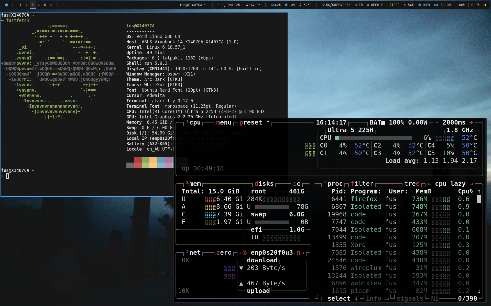

# 🚀 Void Linux BSPWM: Dotfiles & System Backup Suite

A sleek, modular, and high-performance **bspwm** (Binary Space Partitioning Window Manager) desktop environment configured specifically for **Void Linux (`x86_64`)**, paired with an automated synchronization and deployment system for user dotfiles, system configurations, and manual package manifests.

---

## 📑 Table of Contents

- [Overview](#-overview)
- [Repository Structure](#-repository-structure)
- [Quick Start Guide](#-quick-start-guide)
  - [1. Clone Repository & Restore Configurations](#1-clone-repository--restore-configurations)
  - [2. Install Packages via PackagesManual.txt](#2-install-packages-via-packagesmanualtxt)
  - [3. Start / Reload BSPWM](#3-start--reload-bspwm)
- [Synchronization Scripts](#-synchronization-scripts)
  - [CopyFromLocal (Backup Host -> Repo)](#copyfromlocal-backup-host---repo)
  - [CopyToLocal (Restore Repo -> Host + Auto Package Install)](#copytolocal-restore-repo---host--auto-package-install)
  - [CLI Flags & Interactive Prompts](#cli-flags--interactive-prompts)
  - [Managing PathLists.txt](#managing-pathliststxt)
- [📂 Desktop Environment Layout](#-desktop-environment-layout)
- [⚡ Keybindings Cheat Sheet](#-keybindings-cheat-sheet)
  - [🖥️ Applications & Utilities](#-applications--utilities)
  - [🪟 Window Management](#-window-management)
  - [🧭 Workspaces & Multi-Monitor](#-workspaces--multi-monitor)
  - [🔊 Media & Hardware Controls](#-media--hardware-controls)
- [🛠️ Key Components & Void Linux Architecture](#-key-components--void-linux-architecture)
- [🔒 Security & Permissions Handling](#-security--permissions-handling)

---

## 🌟 Overview

This repository provides a complete, modern Void Linux desktop suite:
- **Tiling Window Management**: Fully customized X11 desktop environment built around **bspwm**, **sxhkd**, **polybar**, **rofi**, **dunst**, and **picom**.
- **Void-native Init & Session**: Native integration with Void Linux's **`runit`** and **`elogind`** (using `loginctl` for suspend, reboot, and poweroff).
- **Desktop Ergonomics**: Dynamic multi-monitor switcher profiles, natural touchpad scrolling and gestures (`touchegg`), Dunst OSD volume/brightness progress bars, GTK3 dark menu styling, and auto-dimming screen lock via `betterlockscreen` + `xidlehook`.
- **Zero-Dependency Backup Engine**: `CopyFromLocal.sh` and `CopyToLocal.sh` let you back up or deploy your entire desktop configuration and packages on any fresh Void Linux machine in minutes.

---

## 🗂️ Repository Structure

```text
UbuntuBSPWM/ (Branch: VoidLinux)
├── CopyFromLocal.sh       # Copies dotfiles & system configs into root/, auto-dumps PackagesManual.txt
├── CopyToLocal.sh         # Restores configs from root/ to host & prompts to install PackagesManual.txt
├── PathLists.txt          # Manifest listing all managed dotfiles and system configurations
├── PackagesManual.txt     # List of manually installed XBPS packages (xbps-query -m)
├── readme.md              # Project documentation and keybindings guide
├── .gitignore             # Ignore rules for transient caches, runtime locks, and geometry files
└── root/                  # Mirrored root filesystem tree storing configuration backups
    ├── etc/               # System configurations (ACPI, elogind, X11 touchpad)
    │   ├── acpi/          # ACPI event handlers
    │   ├── elogind/       # Void Linux elogind power & lid-switch config (logind.conf)
    │   └── X11/xorg.conf.d/ # Touchpad libinput configuration (30-touchpad.conf)
    ├── home/
    │   └── fus/           # User configuration directory (bspwm, polybar, rofi, dunst, etc.)
    │       ├── .cargo/bin/ # User cargo binaries (xidlehook)
    │       ├── .config/   # App configs (bspwm, gtk-3.0, polybar, rofi, dunst, fcitx5, copyq, etc.)
    │       ├── .fus/      # Custom shell aliases & utilities (UserAlias.sh, ShellUtils.sh)
    │       ├── .icons/    # Default cursor theme pointer
    │       ├── .xinitrc   # Xorg startup script
    │       ├── .Xresources # X11 cursor theme and resource definitions
    │       ├── .xsettingsd # GTK theme and font daemon settings
    │       └── .zshrc     # Zsh shell configuration
    └── usr/local/bin/     # Custom helper binaries (betterlockscreen, skippy-xd)
```

---

## 🚀 Quick Start Guide

Setting up a fresh Void Linux machine with this configuration:

### 1. Clone Repository & Restore Configurations

Clone the repository and deploy configurations to local system:

```bash
git clone -b VoidLinux https://github.com/ngxx-fus/UbuntuBSPWM.git
cd UbuntuBSPWM

# Preview restore operations (safe dry-run)
./CopyToLocal.sh --dry-run

# Interactive restore (restores files and prompts to install PackagesManual.txt)
./CopyToLocal.sh

# Or restore everything automatically and install packages non-interactively
./CopyToLocal.sh --yes
```

> [!NOTE]
> `CopyToLocal.sh` automatically adapts user home paths across different usernames (e.g. if the repo backup was taken by user `fus`, it will restore seamlessly into `/home/<your-user>/` with proper ownership).

### 2. Install Packages via PackagesManual.txt

If you chose to skip package installation during `./CopyToLocal.sh`, you can manually install the full package list at any time:

```bash
# Update repository database
sudo xbps-install -Syu

# Install all packages from the manifest
xargs -a PackagesManual.txt sudo xbps-install -y
```

### 3. Start / Reload BSPWM

Start your X11 graphical session directly from TTY:

```bash
startx
```

If already running bspwm, reload configurations instantly:

```bash
# Reload sxhkd hotkeys
pkill -USR1 -x sxhkd
# (or press Super + Escape)

# Restart bspwm window manager
bspc wm -r
# (or press Super + Alt + r)
```

---

## 🔄 Synchronization Scripts

The repository includes two scripts designed for daily workflow and machine synchronization. Both scripts support both `bash` and `zsh`.

### CopyFromLocal (Backup Host -> Repo)

Use `CopyFromLocal.sh` when you have customized local configurations and want to save changes into the Git repository:

```bash
# Preview changes before copying
./CopyFromLocal.sh --dry-run

# Interactive backup
./CopyFromLocal.sh

# Non-interactive backup (copies all items and updates PackagesManual.txt)
./CopyFromLocal.sh --yes
```

**Key Features in `CopyFromLocal.sh`:**
- **Automatic Package Manifest Export:** Dumps all manually installed packages via `xbps-query -m > PackagesManual.txt` on every backup run, ensuring your package dependencies remain perfectly synced with your dotfiles.
- **Auto-pruning:** Automatically skips or prunes runtime lockfiles (`*.lock`, `.*.lock`), transient CopyQ clipboard databases (`copyq_tab_*.dat`), and window geometry states so runtime junk never enters version control.
- **Permission Normalization:** Automatically adjusts ownership of system files in `root/` to your current user so `git status`, `git diff`, and `git commit` run smoothly without requiring `sudo`.
- **Dynamic Sudo Check:** Probes file readability first and only asks for `sudo` elevation if a file or directory is truly restricted.
- **Cross-directory execution:** Resolves its own path dynamically; can be invoked from any working directory.

### CopyToLocal (Restore Repo -> Host + Auto Package Install)

Use `CopyToLocal.sh` to apply repository configurations onto the local system:

```bash
# Interactive restore (prompts per item and asks to install PackagesManual.txt)
./CopyToLocal.sh

# Auto-confirm all items and install packages
./CopyToLocal.sh --yes

# Restore dotfiles but skip package installation
./CopyToLocal.sh --skip-packages
```

**Key Features in `CopyToLocal.sh`:**
- **Interactive Package Installation:** Automatically detects `PackagesManual.txt` and prompts the user `Do you want to install packages from PackagesManual.txt? [y/n/a/q]`.
- **Non-destructive Directory Sync:** Updates repository-managed configuration files while preserving any unmanaged local user files.
- **Cross-User Home Mapping:** Automatically detects user folders in `root/home/` and restores into the current user's `$HOME`.
- **System Integrity:** Sets `root:root` ownership on system files (`/etc/`, `/usr/`) and `$USER:$USER` on home files (`$HOME`).
- **Target State Indication:** Shows whether the target already exists or is new before prompting.

### CLI Flags & Interactive Prompts

Both scripts support the following command-line flags:

| Flag | Long Flag | Description |
| :--- | :--- | :--- |
| `-y` | `--yes`, `-a`, `--all` | Run non-interactively; automatically confirm all operations |
| `-n` | `--dry-run` | Preview operations without creating or modifying any files |
| — | `--skip-packages` | *(CopyToLocal only)* Skip installing packages from `PackagesManual.txt` |
| `-h` | `--help` | Display usage instructions and options |

During interactive execution, each item prompts for confirmation:
- `y` (**Yes**): Copy / restore the current item.
- `n` (**No**): Skip the current item.
- `a` (**All**): Confirm the current item and all remaining items automatically.
- `q` (**Quit**): Immediately abort the process.

### Managing PathLists.txt

[`PathLists.txt`](file:///home/fus/.fus/UbuntuBSPWM/PathLists.txt) defines what files and directories are synchronized:

```text
# User configurations ($HOME)
/home/fus/.config/bspwm/
/home/fus/.config/gtk-3.0/
/home/fus/.config/fcitx5/
/home/fus/.config/touchegg/
/home/fus/.config/Thunar/
/home/fus/.config/xfce4/
/home/fus/.config/flameshot/
/home/fus/.config/copyq/
/home/fus/.config/skippy-xd/
/home/fus/.config/polybar/
/home/fus/.config/dunst/
/home/fus/.zshrc
/home/fus/.xinitrc
/home/fus/.xsettingsd
/home/fus/.Xresources
/home/fus/.icons/default/index.theme
/home/fus/.fus/UserAlias.sh
/home/fus/.fus/ShellUtils.sh
/home/fus/.cargo/bin/xidlehook

# System configurations & helper binaries (/etc, /usr)
/etc/X11/xorg.conf.d/
/etc/elogind/logind.conf
/etc/acpi/
/usr/local/bin/skippy-xd
/usr/local/bin/betterlockscreen
```

- Trailing slashes indicate directories (e.g., `~/.config/bspwm/`).
- Paths starting with `~` or `/home/<user>/` are mapped dynamically to the active user's home directory.
- Absolute paths outside `/home` (such as `/etc/` or `/usr/local/bin/`) are handled with elevated permissions when required.
- Blank lines and comments starting with `#` are ignored.

---

## 📂 Desktop Environment Layout

```text
~/.config/bspwm/
├── bspwmrc                      # Main initialization script and window management rules
├── readme.md                    # BSPWM specific guide
├── .gitignore                   # Ignore rules for cache / temporary files
│
├── alacritty/                   # Alacritty terminal emulator configuration
│   └── alacritty.yml
│
├── dunst/                       # Notification daemon configuration
│   └── dunstrc
│
├── picom/                       # X11 compositor (opacity, shadows, fading, rounded corners)
│   └── picom.conf
│
├── polybar/                     # Modular status bar
│   ├── config.ini               # Module definitions and layout
│   └── colors.ini               # Theme color palette
│
├── rofi/                        # Application launcher & modal menus
│   ├── config.rasi              # Universe launcher configuration
│   ├── colors.rasi              # Palette definitions
│   ├── combi.rasi               # Unified launcher theme
│   ├── controlpanel.rasi        # System control panel theme
│   ├── keybinds.rasi            # Keybindings cheat sheet popup
│   ├── popup.rasi               # Shared popup modal theme
│   ├── popup1.rasi              # Secondary popup modal theme
│   └── power.rasi               # Power session menu theme
│
├── scripts/                     # Helper & automation scripts
│   ├── Helper-ChangeBrightness  # Display brightness control with Dunst OSD
│   ├── Helper-ChangeKeyboardBrightness # Keyboard backlight control with Dunst OSD
│   ├── Helper-ChangeVolume      # PulseAudio/ALSA volume control with Dunst OSD
│   ├── Helper-CpuTemp           # Polybar CPU temperature module helper
│   ├── Helper-DisplaySwitching  # Multi-monitor switcher (PC only, Clone, Extend, External)
│   ├── Helper-Help              # Displays keybinding cheat sheet via Rofi
│   ├── Helper-Power             # Session controls (Power off, Reboot, Suspend, Lock via elogind)
│   ├── Helper-ToggleTouchpad    # Enables / disables touchpad on demand
│   ├── Service-Background       # Desktop wallpaper manager
│   ├── Service-Polybar          # Polybar lifecycle launcher
│   └── data/display_config      # Persistent multi-monitor state
│
├── skippy-xd/                   # Exposé-style visual task switcher configuration
│   └── skippy-xd.rc
│
├── sxhkd/                       # Simple X Hotkey Daemon configuration
│   └── sxhkdrc
│
└── wallpaper/                   # Curated wallpapers for FHD and Ultrawide (3440x1440)
```

---

## ⚡ Keybindings Cheat Sheet

Modifier Key: **`Super`** (Windows key).

### 🖥️ Applications & Utilities
| Shortcut | Action | Command / Target |
| :--- | :--- | :--- |
| `Super + Enter` / `Super + r` | Open Terminal | `alacritty` |
| `Alt + Space` | Application Launcher (Universe) | `rofi -show combi` |
| `Super + e` | File Manager | `thunar` |
| `Super + v` | Clipboard History Manager | `copyq toggle` |
| `Super + l` | Lock Screen | `betterlockscreen -l blur` |
| `Super + Tab` | Visual Window Switcher (Exposé) | `skippy-xd` |
| `Alt + Tab` / `Alt + Shift + Tab` | Focus next / previous window | `bspc node -f next/prev.local.!hidden.window` |
| `Super + Space` | Toggle Input Method | `fcitx5` |
| `Super + p` | Display Switching Menu | Multi-monitor profile menu |
| `Super + x` | Power & Session Menu | Shutdown, Reboot, Suspend, Lock (elogind) |
| `Super + /` | Hotkey Cheat Sheet | Visual keybindings help |
| `Super + Esc` | Reload Hotkeys | Reload `sxhkd` configuration |

### 🪟 Window Management
| Shortcut | Action |
| :--- | :--- |
| `Super + q` / `Super + w` | Close focused window (`bspc node -c`) |
| `Super + Shift + w` | Force kill window (`bspc node -k`) |
| `Super + f` | Toggle Fullscreen state |
| `Super + s` | Toggle between Floating and Tiled states |
| `Super + m` | Toggle between Tiled and Monocle (Maximized) layout |
| `Super + {Left, Down, Up, Right}` | Directional window focus (Arrow keys) |
| `Super + {h, j, k, l}` | Directional window focus (Vim keys) |
| `Super + Shift + {Arrows / hjkl}` | Swap focused window with neighbor |
| `Super + Ctrl + {Arrows}` | Move floating window coordinates |
| `Super + Alt + {h, j, k, l}` | Expand window size |
| `Super + Alt + Shift + {h, j, k, l}` | Contract window size |

### 🧭 Workspaces & Multi-Monitor
| Shortcut | Action |
| :--- | :--- |
| `Super + [1-9]` | Switch to Workspace 1–9 on focused monitor |
| `Super + Shift + [1-9]` | Send focused window to Workspace 1–9 |
| `Ctrl + Alt + Left / Right` | Cycle previous / next desktop |
| `Super + comma` / `Super + period` | Focus previous / next physical monitor |
| `Super + Ctrl + Shift + {Arrows}` | Send window to directional monitor |

### 🔊 Media & Hardware Controls
| Shortcut | Action |
| :--- | :--- |
| `XF86AudioRaiseVolume` / `Super + F12` | Volume Up (with Dunst OSD) |
| `XF86AudioLowerVolume` / `Super + F11` | Volume Down (with Dunst OSD) |
| `XF86AudioMute` / `Super + F10` | Mute / Unmute Audio |
| `XF86AudioMicMute` / `XF86Launch5` | Mute / Unmute Microphone |
| `XF86MonBrightnessUp / Down` | Screen Brightness Control |
| `XF86KbdBrightnessUp / Down` | Keyboard Backlight Control |
| `XF86TouchpadToggle` | Enable / Disable Touchpad |
| `Print` | Fullscreen Screenshot (`flameshot full`) |
| `Super + Shift + s` | Interactive Area Screenshot (`flameshot gui`) |

---

## 🛠️ Key Components & Void Linux Architecture

- **Init System & Daemons**:
  - **`runit`**: Void's fast and lightweight init system and service supervision (`/var/service/`).
  - **`elogind`**: Replaces `systemd-logind` for power and session control. Commands like `loginctl suspend`, `loginctl reboot`, and `loginctl poweroff` are used in [`Helper-Power`](file:///home/fus/.config/bspwm/scripts/Helper-Power) and [`betterlockscreen`](file:///usr/local/bin/betterlockscreen).
  - `/etc/elogind/logind.conf` handles lid switch behavior (ignoring lid close on external displays).
- **Audio & Media**:
  - Full PipeWire stack (`pipewire`, `wireplumber`, `pipewire-pulse`) managed cleanly via user runtime.
- **Window Management & Hotkeys**:
  - `bspwm` arranges windows in a binary space partition tree.
  - `sxhkd` intercepts X11 keyboard events.
- **Touchpad Experience**:
  - `touchegg` enables multi-finger gestures (swipe up for window exposé, swipe left/right for workspaces).
  - `/etc/X11/xorg.conf.d/30-touchpad.conf` configures natural scrolling, tap-to-click, and palm detection via `libinput`.
- **GTK Context Menus & Visuals**:
  - `~/.config/gtk-3.0/gtk.css` combined with `picom.conf` eliminates the 24-bit black corner artifact on non-CSD menus in tiling window managers.
  - `~/.xsettingsd` provides theme and icon definitions to GTK applications without requiring GNOME Settings Daemon.

---

## 🔒 Security & Permissions Handling

- **Exclusion of Sensitive Data**: The `.gitignore` and `CopyFromLocal.sh` scripts prevent CopyQ clipboard history (`copyq_tab_*.dat`), authentication keys, lockfiles, and application cache from being committed.
- **Root vs User Permissions**:
  - Configuration files copied to `$HOME` are set to `$USER:$USER`.
  - System files copied to `/etc/` or `/usr/` are restored as `root:root`.
  - When backing up to `root/`, all files are normalized to user ownership to enable normal Git operations without needing `sudo`.

## Demo 

